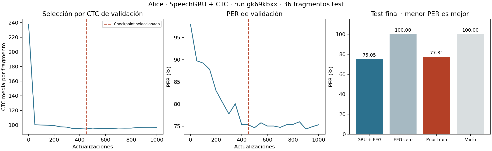

# Adaptación de nuestro decodificador a Alice EEG

El autor confirmó el 20 de octubre de 2026 que quiere **adaptar el trabajo
GRU + CTC de Willett a otros datos**, sin replicar el método del artículo de
Alice. Esta es la línea activa. El piloto anterior EEG→`sound_power` queda
como exploración histórica, con su objetivo en auditoría.

## Qué se reutiliza y qué se adapta

| Componente | Adaptación Alice |
|---|---|
| `SpeechGRU` | La misma clase PyTorch: transformación de entrada, Softsign, ventanas temporales, GRU unidireccionales, estado inicial entrenable y salida de fonemas. |
| Tamaño del modelo | 60 canales EEG, proyección a 60, dos capas de 128 unidades, kernel 8 y stride 2 a 64 Hz; 342.389 parámetros. El perfil T12 conserva sus cinco capas de 1.024. |
| Etiquetas | Mismo `PhonemeEncoder`, g2p-en 2.1.0, 40 símbolos incluyendo SIL y blank CTC 40. Se recomponen contracciones separadas en la anotación, como `would` + `nt`. |
| Lotes | Mismos `SpeechSample`, `SpeechBatch`, padding y objetivos concatenados; mismo muestreador y acumulación por microlotes. |
| Entrenamiento | Se llaman las funciones CTC, Adam con epsilon-hat de TensorFlow, L2 y clipping ya implementadas para T12. |
| Evaluación | Misma función `evaluar_habla` y PER greedy agregado; nuevo split de validación para elegir el checkpoint por CTC. |
| Pesos | Inicialización desde cero. No se cargan pesos intracorticales T12 sobre canales EEG. |

La tarea es EEG de **escucha → secuencia de fonemas**. CTC permite supervisar
la secuencia sin indicar el instante de cada fonema, suponiendo orden monótono.
Su compatibilidad matemática no garantiza que el EEG permita recuperar el
contenido hablado con buena calidad.

## Datos y separación

Sub-001 de [NEMAR nm000180 v1.1.3](https://www.nemar.org/dataset/nm000180),
fuente del estudio de [Brennan y Hale, 2019](https://doi.org/10.1371/journal.pone.0207741).
Doce archivos fijados por tamaño/hash: 91.467.525 bytes, con EEG BrainVision,
metadatos, eventos y CSV original. Los datos tienen licencia CC-BY-4.0.

- Entrada exclusivamente de los 60 canales EEG buenos. Se excluyen VEOG y Aux5.
  No entran audio, texto, `sound_power`, frecuencia léxica ni otros predictores.
- Segmentos 1–8 para train, 9–10 para val y 11–12 para test, separados antes
  del filtrado. No se modifica `src/data/splits.py` ni la selección T12.
- Referencia media, filtro causal 0,5–20 Hz de orden 4 por segmento y remuestreo
  offline a 64 Hz. Media/desviación calculadas exclusivamente sobre train.
- Fragmentos de hasta ocho palabras reconstruidas, sin cruzar segmento,
  frase ni hueco en las anotaciones. Contexto de 100 ms antes y 500 ms después;
  se descartan fragmentos que entren en los márgenes de 2 s de cada segmento.
- Se verifica la correspondencia por `Order` con el CSV y que el desplazamiento
  EEG/audio sea estable dentro de cada segmento, con tolerancia de 10 ms.
  El rango observado es inferior a 2 ms en los doce segmentos.
- Los tiempos de palabras delimitan fragmentos y referencias. El modelo no
  recibe esos tiempos como características; aún no detecta límites por sí solo.
- Se comprueba que la salida temporal permita CTC, incluyendo la separación
  necesaria entre IDs consecutivos iguales. No se truncan referencias.

Quedan **190/44/36 fragmentos** de train/val/test, con 1.349/310/262 tokens
anotados respectivamente. Las duraciones son aproximadamente 0,76–5,18 s.
Los fonemas son referencias generadas desde texto; no anotaciones fonéticas
manuales ni silencios acústicos alineados. SIL se inserta entre palabras
siguiendo el código T12 y participa en el PER principal.

## Ejecutar desde la raíz del proyecto

Con el entorno T12 existente no se necesitan paquetes nuevos. Para un entorno
dedicado están fijadas las dependencias en `requirements-alice.txt`.

```bash
python scripts/get_alice.py --catalogo docs/datasets/alice_eeg/catalogo_ctc.json
python scripts/get_phoneme_resources.py --config configs/alice_ctc.yaml
python scripts/prepare_alice_ctc.py --config configs/alice_ctc.yaml
OMP_NUM_THREADS=2 OPENBLAS_NUM_THREADS=2 MKL_NUM_THREADS=2 \
    python run.py --config configs/alice_ctc.yaml
```

`configs/alice_ctc.yaml` pide 1.000 actualizaciones, lote 8, Adam-TF,
learning rate lineal con horizonte de 1.000 pasos (de 0,02 a 0,00002 en las
actualizaciones ejecutadas), validación cada 50 y
tras el primer paso. Tiene un límite suave de **180 s** comprobado entre pasos;
evaluación final, guardado y sincronización pueden añadir tiempo. Usa CPU con
dos hilos y W&B online en `tiiac-2026`. El perfil de 50 pasos
`configs/alice_ctc_cpu.yaml` se conserva para una comprobación corta y registra
offline. Ninguno modifica el experimento T12.

Se guarda `runs/alice_ctc/ID_RUN/mejor_val.pt`, con pesos, configuración,
vocabulario, canales, normalización y hash del manifiesto preparado. La
selección utiliza únicamente la CTC de val; test se calcula después de
restaurar ese archivo. `resultado.json` y `predicciones_test.json` conservan
medidas, controles, referencias e hipótesis. Datos, pesos y tracking están
ignorados por Git.

```bash
python run.py --config configs/alice_ctc.yaml --solo-evaluar \
    --checkpoint runs/alice_ctc/ID_RUN/mejor_val.pt
python scripts/report_alice_ctc.py --run-dir runs/alice_ctc/ID_RUN
```

La evaluación desde checkpoint no crea optimizador ni actualiza pesos;
rechaza cachés, arquitectura o vocabulario incompatibles. No reanuda el
entrenamiento. El script de figura añade un diagnóstico descriptivo sin SIL;
esa métrica no se utiliza para elegir pesos.

## Colab

Abrir `notebooks/05_alice_colab.ipynb` y ejecutar en orden. Reutiliza el
entorno T12 si sus versiones son compatibles; en otro caso crea uno aislado
con Python 3.12.11 y Torch CPU. Guarda snapshot de fuentes, YAML, logs,
checkpoint y resultados en un directorio nuevo de Drive. Usa W&B online y
comprueba la recarga con un segundo run de evaluación, sin entrenar otra vez.
La estructura, sintaxis y snapshot se verifican localmente; falta ejecutar
este lanzador nuevo en una VM de Colab.

```bash
python scripts/export_colab.py --perfil alice
```

Ese comando actualiza solo el notebook 05. El notebook 04 conserva el snapshot
y las salidas del entrenamiento T12 terminado por el autor.

## Primera ejecución medida

[Run gk69kbxx en W&B](https://wandb.ai/aaurre-deusto/tiiac-2026/runs/gk69kbxx):
1.000 actualizaciones en **97,8044 s** de bucle CPU con validación y guardados;
no alcanzó el límite temporal. Mejor CTC de val en el paso 450. El test contiene
36 fragmentos y 1.102 fonemas, incluyendo SIL.

| Predicción en test | Errores / fonemas | PER |
|---|---:|---:|
| GRU con EEG | 827 / 1.102 | 75,05 % |
| Prior de train: ocho SIL por fragmento | 852 / 1.102 | 77,31 % |
| Mismo modelo con EEG sustituido por ceros | 1.102 / 1.102 | 100 % |
| Secuencia vacía | 1.102 / 1.102 | 100 % |

El prior usa el símbolo más frecuente y la mediana de sus apariciones por
fragmento de train; no se ajusta con las etiquetas test. La diferencia frente
a él es pequeña. Son resultados exploratorios, no una validación de un
decodificador de habla funcional ni de que el contenido se recupere del EEG.
El control de ceros no descarta artefactos u otros confusores.

Como descripción posterior, quitando SIL de referencia e hipótesis el PER
es **90,89 % (768/845)**. Se predijeron 434 símbolos, de los que 266 fueron SIL.
No convertir `1 − PER` en exactitud ni comparar directamente este PER con el
de T12: cambian modalidad, tarea, datos y protocolo. No hay WER ni modelo
de lenguaje. La limpieza ICA y la validación entre participantes quedan pendientes.

La recarga se ejecutó en un proceso nuevo y cero actualizaciones: run local
`fdvgwaol`. La evidencia, hashes y comprobación de igualdad están en
`docs/resultados/alice_ctc_gk69kbxx.json` y `alice_ctc_gk69kbxx_recarga.json`.
La discusión científica y las decisiones de la entrega corresponden al autor.


